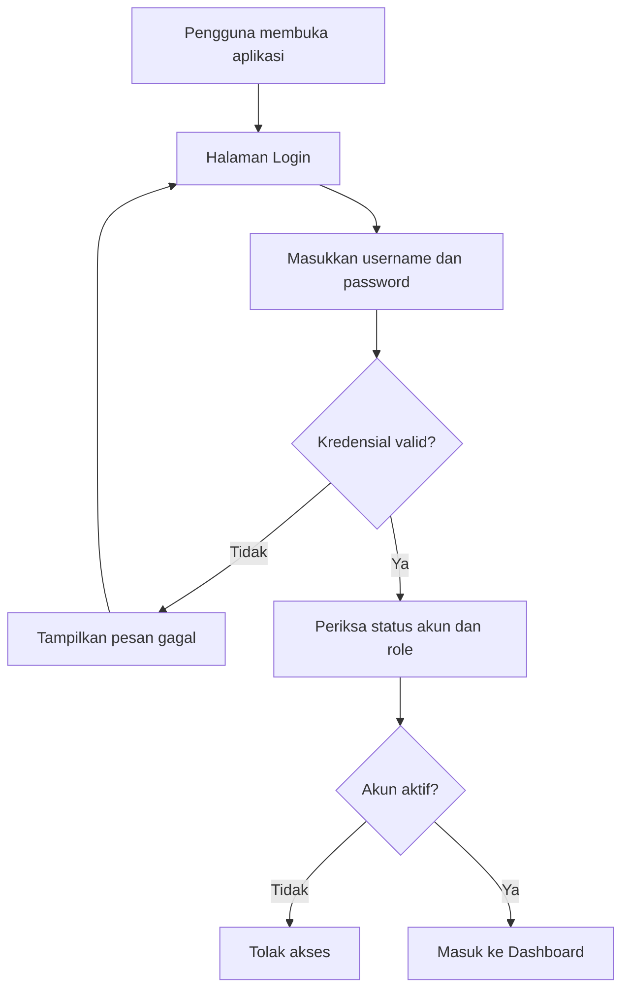
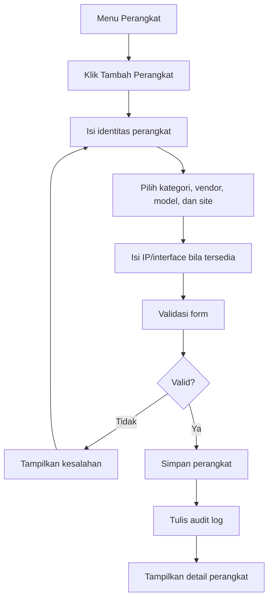
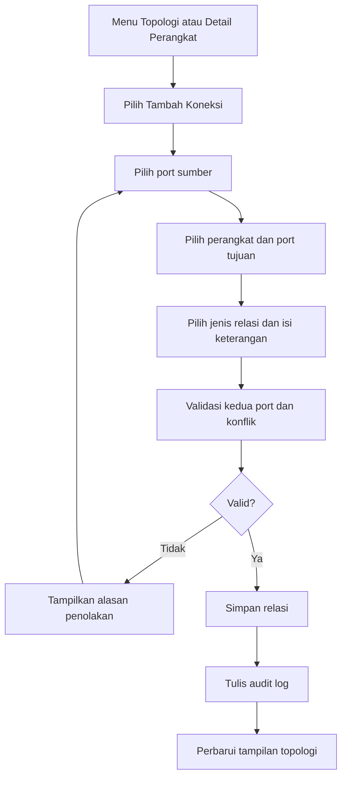
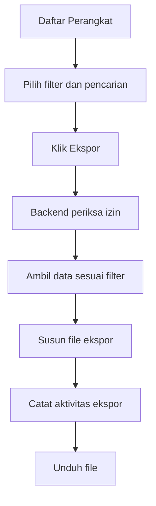
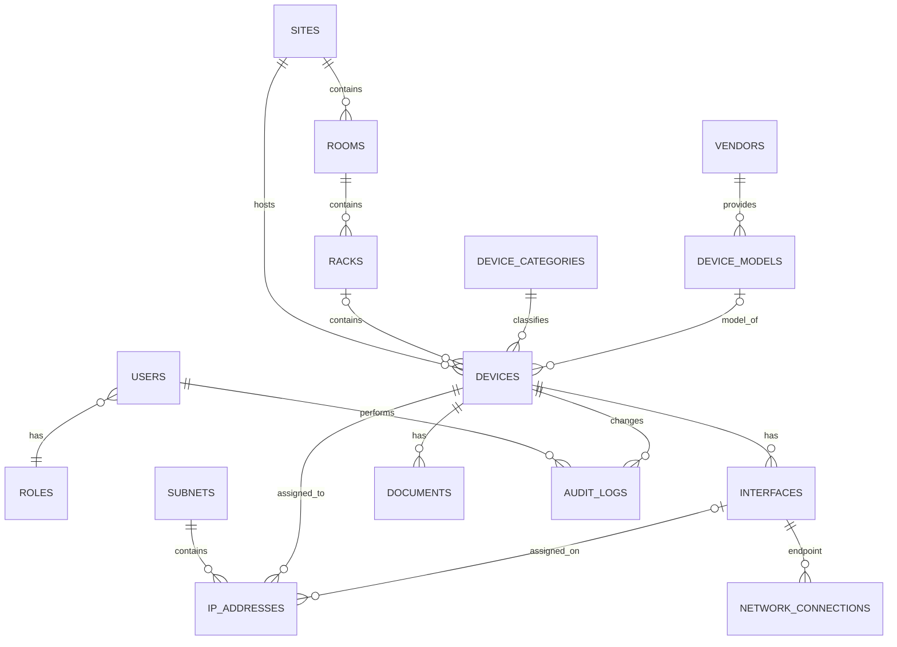
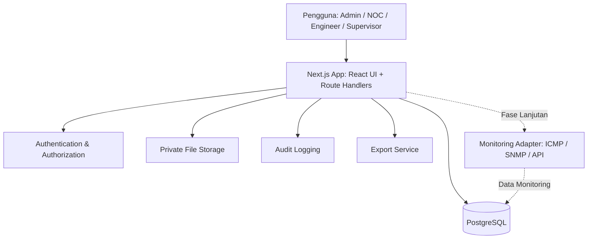

# PRODUCT REQUIREMENTS DOCUMENT (PRD)

# Network Inventory Management System (NIMS)

**Dokumen:** Product Requirements Document  
**Nama Produk:** Network Inventory Management System (NIMS)  
**Versi Dokumen:** 1.0  
**Status:** Draft – sebagai dasar analisis, perancangan, dan pengembangan  
**Tanggal:** 18 November 2026  
**Target Pengguna:** Tim Network Operation Center (NOC), Network Engineer, Administrator Infrastruktur, dan Manajemen ISP  
**Platform:** Web Application  
**Bahasa Antarmuka:** Bahasa Indonesia (dapat dikembangkan menjadi multibahasa)

---

## Riwayat Dokumen

| Versi | Tanggal | Keterangan |
|---|---|---|
| 1.0 | 18 November 2026 | Penyusunan PRD awal untuk Network Inventory Management System |

## 1. Ringkasan Produk

### 1.1 Latar Belakang

Perusahaan Internet Service Provider (ISP) mengelola infrastruktur jaringan yang terdiri dari berbagai perangkat dan lokasi, seperti router core, router distribusi, switch, Optical Line Terminal (OLT), Optical Network Terminal (ONT), server, perangkat transmisi, serta site Point of Presence (POP). Setiap perangkat memiliki informasi yang perlu didokumentasikan, antara lain hostname, alamat IP manajemen, vendor, model, nomor seri, lokasi pemasangan, fungsi perangkat, interface, hubungan koneksi, status inventaris, dan dokumen pendukung.

Dalam operasional sehari-hari, informasi tersebut dapat tersebar di spreadsheet, dokumen konfigurasi, catatan teknisi, atau aplikasi yang berbeda. Kondisi ini berpotensi menimbulkan beberapa masalah: data perangkat sulit dicari, informasi tidak konsisten, perubahan perangkat tidak terdokumentasi, hubungan antarperangkat sulit ditelusuri, serta proses serah terima pekerjaan menjadi lebih lama. Ketika terjadi gangguan, tim NOC juga membutuhkan waktu untuk memastikan perangkat mana yang terkait, lokasi perangkat, jalur koneksi, dan informasi teknis lainnya.

Network Inventory Management System (NIMS) dikembangkan sebagai aplikasi web terpusat untuk mencatat, mengelola, menelusuri, dan mendokumentasikan aset serta hubungan infrastruktur jaringan ISP. Sistem ini menyediakan data inventaris yang terstruktur dan dapat diakses berdasarkan hak akses pengguna. Sistem juga menyediakan pemetaan hubungan antarperangkat (*Network Relationship Mapping*) agar tim NOC dapat memahami keterkaitan perangkat dari sisi dokumentasi.

NIMS pada tahap awal berfokus pada pengelolaan data inventaris dan dokumentasi. NIMS **bukan** pengganti sistem monitoring jaringan. Status seperti “Aktif” atau “Tidak Aktif” pada inventaris adalah status administrasi/perangkat menurut catatan pengguna, bukan hasil pemeriksaan konektivitas secara real-time. Integrasi ping, SNMP, API perangkat, dan notifikasi monitoring dapat dikembangkan pada fase lanjutan setelah fondasi inventaris stabil.

### 1.2 Ringkasan Solusi

NIMS menyediakan satu sumber data terpusat (*single source of truth*) untuk informasi infrastruktur jaringan. Pengguna dapat:

1. Mendaftarkan dan mengelola perangkat jaringan.
2. Mengelola lokasi POP, site pelanggan, ruang perangkat, dan rak.
3. Mendokumentasikan alamat IP, subnet, VLAN, interface, serta port.
4. Mencatat hubungan koneksi antarport dan antarperangkat.
5. Menampilkan topologi jaringan berdasarkan data hubungan yang telah dicatat.
6. Menyimpan dokumen pendukung seperti foto, diagram, dan file konfigurasi yang telah disetujui untuk disimpan.
7. Melihat riwayat perubahan data dan aktivitas pengguna.
8. Melakukan pencarian, filter, dan ekspor laporan inventaris.

### 1.3 Pernyataan Produk

“Platform inventaris jaringan terpusat yang membantu tim ISP mendokumentasikan aset, alamat, lokasi, port, dan hubungan koneksi jaringan secara konsisten, mudah ditelusuri, serta dapat dipertanggungjawabkan.”

### 1.4 Tujuan Dokumen

PRD ini menjadi acuan bagi pemilik proyek, analis, UI/UX designer, developer, tester, dan pembimbing Kerja Praktik untuk menyepakati kebutuhan produk sebelum pembangunan aplikasi dimulai. Dokumen ini menjelaskan masalah yang diselesaikan, target pengguna, ruang lingkup, requirement, aturan bisnis, model data konseptual, alur kerja, kriteria penerimaan, dan tahapan rilis.

---

## 2. Visi, Tujuan, dan Indikator Keberhasilan

### 2.1 Visi Produk

Menyediakan sistem dokumentasi infrastruktur jaringan ISP yang terpusat, akurat, mudah diperbarui, dan dapat digunakan oleh tim NOC sebagai referensi operasional.

### 2.2 Tujuan Produk

- Mengurangi ketergantungan pada pencatatan inventaris yang tersebar di banyak file.
- Menstandarkan format data perangkat dan lokasi.
- Mempercepat pencarian informasi teknis perangkat.
- Memudahkan penelusuran hubungan koneksi antarperangkat.
- Menjaga histori perubahan data agar perubahan dapat ditelusuri.
- Menyediakan laporan inventaris yang dapat diekspor.
- Menyiapkan fondasi data untuk pengembangan monitoring dan otomasi pada masa mendatang.

### 2.3 Indikator Keberhasilan (KPI)

Target di bawah adalah target awal proyek dan perlu disesuaikan setelah kondisi operasional perusahaan diketahui.

| Indikator | Target Awal | Cara Pengukuran |
|---|---:|---|
| Kelengkapan data perangkat wajib | ≥ 95% pada perangkat yang telah dimigrasikan | Persentase perangkat dengan seluruh field wajib terisi |
| Keberhasilan pencarian perangkat | ≥ 95% skenario uji menemukan perangkat yang benar | Pengujian kata kunci, hostname, IP, ID, serial number |
| Keberhasilan ekspor | 100% pada skenario ekspor yang didukung | Membandingkan jumlah record pada hasil ekspor dan filter |
| Pencatatan perubahan | 100% perubahan data penting tercatat | Audit log untuk create, update, delete/arsip, dan perubahan relasi |
| Integritas relasi jaringan | Tidak ada relasi yatim (*orphan relationship*) | Validasi foreign key dan pengujian relasi |
| Hak akses | Tidak ada akses tanpa izin pada skenario uji | Pengujian role dan akses endpoint/halaman |
| Kemudahan penggunaan | Pengguna uji dapat menyelesaikan tugas inti tanpa bantuan intensif | Uji tugas dengan operator NOC |

### 2.4 Prinsip Produk

1. **Data harus konsisten:** gunakan master data untuk vendor, tipe perangkat, lokasi, dan kategori.
2. **Perubahan harus terlacak:** perubahan data kritis wajib memiliki audit trail.
3. **Relasi harus jelas:** koneksi antarperangkat dicatat berdasarkan port/interface, bukan hanya catatan bebas.
4. **Aman secara default:** akses minimum sesuai peran dan file sensitif tidak ditampilkan ke semua pengguna.
5. **MVP harus realistis:** prioritaskan pendataan dan pencarian sebelum integrasi otomatis ke perangkat produksi.
6. **Tidak mengarang status real-time:** status administratif harus dibedakan dari status hasil monitoring.

---

## 3. Ruang Lingkup Produk

### 3.1 In-Scope (Termasuk dalam Produk)

Fitur berikut termasuk ruang lingkup utama NIMS versi awal:

- Login, logout, dan manajemen sesi.
- Role-Based Access Control (RBAC).
- Dashboard inventaris.
- Manajemen perangkat jaringan.
- Manajemen lokasi/site/POP.
- Manajemen vendor dan model perangkat.
- Manajemen interface dan port.
- Manajemen IP address dan subnet dasar.
- Dokumentasi VLAN dasar.
- Manajemen hubungan koneksi antarport/perangkat.
- Visualisasi topologi berdasarkan hubungan yang dicatat.
- Pencarian dan filter data.
- Lampiran dokumen/foto dengan pembatasan akses.
- Riwayat perubahan/audit log.
- Ekspor data ke CSV/XLSX dan/atau PDF sesuai kebutuhan implementasi.
- Validasi input dan pencegahan duplikasi data penting.

### 3.2 Out-of-Scope untuk MVP

Fitur berikut tidak menjadi kewajiban versi pertama, kecuali disetujui sebagai tambahan:

- Monitoring ping/ICMP secara berkelanjutan.
- Monitoring SNMP CPU, RAM, temperatur, optical power, dan traffic.
- Pengambilan konfigurasi perangkat secara otomatis.
- Push konfigurasi atau perubahan konfigurasi ke router, switch, OLT, atau ONT.
- Integrasi langsung dengan ACS/TR-069.
- Sistem ticketing dan incident management penuh.
- Billing, CRM, dan manajemen paket pelanggan.
- Auto-discovery perangkat dari jaringan.
- Penentuan jalur jaringan otomatis berbasis routing protocol.
- Peta geografis GIS yang memerlukan koordinat dan layanan peta eksternal.
- Aplikasi mobile native.
- High availability multi-region dan disaster recovery tingkat enterprise.

**Catatan:** fitur monitoring dan integrasi perangkat dapat menjadi roadmap fase kedua atau ketiga. NIMS tetap harus dapat digunakan secara mandiri tanpa akses langsung ke perangkat jaringan produksi.

### 3.3 Batasan MVP

Untuk menjaga proyek dapat diselesaikan dalam periode Kerja Praktik:

- Fokus pada satu organisasi/perusahaan (*single tenant*).
- Satu basis data utama.
- Pengguna dan role dikelola administrator.
- Data perangkat diinput manual atau melalui impor template.
- Visualisasi topologi menggunakan relasi yang dicatat pengguna.
- File yang diunggah dibatasi tipe dan ukuran.
- Ekspor hanya memuat data yang boleh diakses pengguna.
- Integrasi live monitoring tidak menjadi syarat rilis MVP.

---

## 4. Target Pengguna dan Persona

### 4.1 Administrator Sistem

**Tanggung jawab:** mengelola akun, role, master data, konfigurasi aplikasi, dan pengaturan umum.

**Kebutuhan:**
- Membuat, mengubah, menonaktifkan akun pengguna.
- Menetapkan hak akses berdasarkan role.
- Mengelola daftar vendor, model, kategori, dan lokasi.
- Melihat seluruh audit log.
- Mengelola kebijakan penyimpanan dokumen.

### 4.2 Operator NOC

**Tanggung jawab:** menggunakan data inventaris sebagai referensi operasional harian.

**Kebutuhan:**
- Mencari perangkat berdasarkan hostname, IP, serial number, atau lokasi.
- Melihat detail perangkat, port, alamat, serta hubungan koneksi.
- Melihat topologi jaringan.
- Menambahkan catatan atau memperbarui data sesuai kewenangan.
- Mengunduh laporan inventaris yang diizinkan.

### 4.3 Network Engineer

**Tanggung jawab:** mengelola dokumentasi teknis dan hubungan jaringan.

**Kebutuhan:**
- Mendaftarkan perangkat dan interface.
- Mencatat koneksi antarperangkat.
- Mengelola subnet, IP, VLAN, dan informasi port.
- Mengunggah diagram atau dokumentasi teknis.
- Meninjau perubahan data dan menjaga akurasi relasi.

### 4.4 Supervisor/Manajer NOC

**Tanggung jawab:** mengawasi kelengkapan inventaris dan pemeliharaan dokumentasi.

**Kebutuhan:**
- Melihat ringkasan jumlah perangkat dan lokasi.
- Mengetahui perangkat yang belum lengkap datanya.
- Melihat perangkat berdasarkan tipe, vendor, site, dan status inventaris.
- Mengakses laporan dan histori perubahan.

### 4.5 Matriks Hak Akses Awal

| Modul/Aksi | Admin | Network Engineer | Operator NOC | Supervisor |
|---|---|---|---|---|
| Melihat dashboard | Ya | Ya | Ya | Ya |
| Melihat perangkat | Ya | Ya | Ya | Ya |
| Menambah perangkat | Ya | Ya | Sesuai izin | Tidak/opsional |
| Mengubah perangkat | Ya | Ya | Sesuai izin | Tidak/opsional |
| Mengarsipkan perangkat | Ya | Terbatas | Tidak | Tidak |
| Mengelola port dan relasi | Ya | Ya | Lihat saja/opsional | Lihat saja |
| Mengelola IP/VLAN | Ya | Ya | Lihat saja/opsional | Lihat saja |
| Mengelola lokasi/master data | Ya | Terbatas | Tidak | Tidak |
| Mengunggah dokumen | Ya | Ya | Sesuai izin | Tidak/opsional |
| Melihat dokumen terbatas | Sesuai izin | Sesuai izin | Sesuai izin | Sesuai izin |
| Melihat audit log | Ya | Log terkait/opsional | Tidak | Ya/opsional |
| Mengelola pengguna dan role | Ya | Tidak | Tidak | Tidak |
| Ekspor data | Ya | Ya | Sesuai izin | Ya |

Hak akses final harus disepakati dengan perusahaan. Implementasi wajib memeriksa izin di backend, bukan hanya menyembunyikan tombol di frontend.

---

## 5. Kebutuhan Fungsional

Prioritas requirement menggunakan penanda:

- **P0 – Must Have:** wajib tersedia pada MVP.
- **P1 – Should Have:** penting, dikerjakan jika waktu dan sumber daya memungkinkan.
- **P2 – Could Have:** tambahan yang dapat ditunda.

### 5.1 Autentikasi dan Manajemen Pengguna

| ID | Requirement | Prioritas |
|---|---|---|
| FR-AUTH-001 | Pengguna dapat login menggunakan username/email dan password yang valid. | P0 |
| FR-AUTH-002 | Sistem menolak login dengan kredensial salah dan menampilkan pesan yang tidak membocorkan apakah username terdaftar. | P0 |
| FR-AUTH-003 | Pengguna dapat logout dan sesi menjadi tidak berlaku. | P0 |
| FR-AUTH-004 | Admin dapat membuat, mengubah, menonaktifkan, dan mengaktifkan akun. | P0 |
| FR-AUTH-005 | Admin dapat menetapkan role kepada pengguna. | P0 |
| FR-AUTH-006 | Sistem membatasi akses menu dan operasi berdasarkan role/permission. | P0 |
| FR-AUTH-007 | Sistem mencatat login berhasil/gagal dan perubahan hak akses. | P1 |
| FR-AUTH-008 | Sistem menyediakan proses reset password yang aman. | P1 |

**Aturan:**
- Password harus disimpan dalam bentuk hash yang kuat, bukan plaintext.
- Akun yang dinonaktifkan tidak dapat login.
- Pengguna tidak boleh menaikkan hak aksesnya sendiri.
- Sesi harus memiliki masa berlaku dan mekanisme invalidasi.

### 5.2 Dashboard

| ID | Requirement | Prioritas |
|---|---|---|
| FR-DASH-001 | Dashboard menampilkan total perangkat terdaftar. | P0 |
| FR-DASH-002 | Dashboard menampilkan jumlah perangkat berdasarkan kategori/jenis. | P0 |
| FR-DASH-003 | Dashboard menampilkan jumlah site/lokasi terdaftar. | P0 |
| FR-DASH-004 | Dashboard menampilkan jumlah perangkat berdasarkan status inventaris. | P0 |
| FR-DASH-005 | Dashboard menampilkan perangkat dengan data wajib yang belum lengkap. | P1 |
| FR-DASH-006 | Dashboard menyediakan tautan cepat menuju daftar perangkat, site, dan topologi. | P1 |
| FR-DASH-007 | Dashboard menampilkan aktivitas perubahan terbaru sesuai hak akses. | P1 |

**Komponen dashboard yang disarankan:**

- Kartu total perangkat.
- Kartu total lokasi/site.
- Ringkasan perangkat per kategori (router, switch, OLT, ONT, server, lainnya).
- Ringkasan status inventaris (planned, active, maintenance, retired, lost).
- Daftar data yang belum lengkap.
- Aktivitas terakhir.

Jangan memberi label “Online/Offline Real-Time” pada dashboard MVP apabila sistem belum melakukan pemeriksaan konektivitas. Gunakan istilah “Status Inventaris” atau “Status Administratif”.

### 5.3 Manajemen Perangkat (Device Management)

| ID | Requirement | Prioritas |
|---|---|---|
| FR-DEV-001 | Pengguna berwenang dapat menambahkan perangkat baru. | P0 |
| FR-DEV-002 | Pengguna dapat melihat daftar perangkat dalam tabel. | P0 |
| FR-DEV-003 | Pengguna dapat melihat detail perangkat. | P0 |
| FR-DEV-004 | Pengguna berwenang dapat mengubah data perangkat. | P0 |
| FR-DEV-005 | Pengguna berwenang dapat mengarsipkan perangkat. | P0 |
| FR-DEV-006 | Sistem mendukung kategori perangkat seperti router, switch, OLT, ONT, server, radio, dan perangkat lain. | P0 |
| FR-DEV-007 | Sistem menyimpan hostname, device code, vendor, model, serial number, lokasi, fungsi, dan status inventaris. | P0 |
| FR-DEV-008 | Sistem memvalidasi device code/asset tag agar tidak duplikat. | P0 |
| FR-DEV-009 | Sistem dapat mencari perangkat berdasarkan hostname, IP, serial number, device code, model, atau lokasi. | P0 |
| FR-DEV-010 | Sistem dapat memfilter berdasarkan tipe, vendor, lokasi, status, dan role jaringan. | P0 |
| FR-DEV-011 | Sistem mendukung field tambahan sesuai kategori perangkat. | P1 |
| FR-DEV-012 | Sistem menyediakan impor perangkat menggunakan template CSV/XLSX. | P1 |
| FR-DEV-013 | Sistem menyediakan ekspor daftar perangkat sesuai filter. | P0 |

**Field data perangkat yang direkomendasikan:**

| Field | Wajib? | Keterangan |
|---|---|---|
| Device ID | Otomatis | Primary key internal |
| Device Code/Asset Tag | Ya | Kode inventaris unik, contoh `NOC-RTR-001` |
| Hostname | Ya | Nama perangkat yang digunakan di jaringan |
| Category | Ya | Router, switch, OLT, ONT, server, radio, lainnya |
| Vendor | Ya | MikroTik, Huawei, ZTE, Cisco, Juniper, dan lainnya |
| Model | Disarankan | Model perangkat |
| Serial Number | Kondisional | Nomor seri jika tersedia |
| Management IP | Disarankan | IP administrasi; dikelola pula pada modul IPAM |
| Network Role | Disarankan | Core, distribution, access, aggregation, CPE, server |
| Site/Location | Ya | Lokasi pemasangan |
| Rack/Room | Opsional | Ruang dan rak perangkat |
| Administrative Status | Ya | Planned, Active, Maintenance, Retired, Lost |
| Installation Date | Opsional | Tanggal pemasangan |
| Warranty Expiry | Opsional | Tanggal akhir garansi |
| Owner/Team | Opsional | Tim penanggung jawab |
| Description | Opsional | Keterangan tambahan |
| Created By/At | Otomatis | Pembuat dan waktu pembuatan |
| Updated By/At | Otomatis | Pengubah terakhir dan waktu perubahan |

**Status inventaris yang disarankan:**

- `PLANNED`: perangkat sudah direncanakan tetapi belum dipasang.
- `ACTIVE`: perangkat tercatat digunakan.
- `MAINTENANCE`: perangkat sedang dalam pemeliharaan.
- `RETIRED`: perangkat sudah tidak digunakan dan dipensiunkan.
- `LOST`: perangkat hilang atau tidak diketahui keberadaannya.

Status ini tidak sama dengan kondisi konektivitas. Perangkat dengan status inventaris `ACTIVE` masih dapat mengalami gangguan jaringan. Status konektivitas hanya dapat ditentukan oleh modul monitoring terpisah.

### 5.4 Manajemen Lokasi dan Site

| ID | Requirement | Prioritas |
|---|---|---|
| FR-SITE-001 | Pengguna berwenang dapat menambahkan, mengubah, melihat, dan mengarsipkan lokasi. | P0 |
| FR-SITE-002 | Sistem mendukung tipe lokasi seperti POP, data center, kantor, site pelanggan, shelter, dan lokasi lain. | P0 |
| FR-SITE-003 | Sistem menyimpan kode site, nama, alamat, wilayah, dan deskripsi. | P0 |
| FR-SITE-004 | Sistem dapat menampilkan perangkat yang terpasang pada suatu site. | P0 |
| FR-SITE-005 | Sistem mendukung hierarki lokasi, misalnya wilayah > kota > site > ruang/rak. | P1 |
| FR-SITE-006 | Sistem dapat menyimpan koordinat geografis sebagai data opsional. | P2 |
| FR-SITE-007 | Sistem mencegah penghapusan lokasi yang masih dipakai perangkat tanpa proses pemindahan/arsip. | P0 |

**Informasi site yang disarankan:**
- Kode site.
- Nama site/POP.
- Tipe site.
- Alamat.
- Kota/kabupaten dan provinsi.
- Koordinat latitude/longitude (opsional).
- Kontak/PIC site (bila diizinkan perusahaan).
- Keterangan akses atau jam operasional (opsional dan dibatasi).
- Status site (active/inactive/maintenance).

### 5.5 Vendor dan Model Perangkat

| ID | Requirement | Prioritas |
|---|---|---|
| FR-VEN-001 | Admin dapat mengelola master vendor. | P0 |
| FR-VEN-002 | Admin/engineer dapat mengelola model perangkat di bawah vendor. | P0 |
| FR-VEN-003 | Model dapat memiliki kategori dan atribut teknis dasar. | P1 |
| FR-VEN-004 | Sistem tidak menghapus vendor/model yang sedang digunakan perangkat tanpa penanganan relasi. | P0 |

Tujuan master data adalah menghindari variasi penulisan, misalnya `Mikrotik`, `MikroTik`, dan `mikrotik` dianggap sebagai vendor berbeda.

### 5.6 Manajemen Interface dan Port

| ID | Requirement | Prioritas |
|---|---|---|
| FR-PORT-001 | Pengguna berwenang dapat menambahkan interface/port untuk suatu perangkat. | P0 |
| FR-PORT-002 | Setiap port memiliki nama/interface identifier yang unik dalam satu perangkat. | P0 |
| FR-PORT-003 | Port dapat memiliki tipe, kecepatan, media, deskripsi, dan status administratif. | P0 |
| FR-PORT-004 | Sistem dapat mencatat VLAN untagged/native dan daftar VLAN tagged jika diperlukan. | P1 |
| FR-PORT-005 | Sistem menampilkan perangkat tujuan dan port pasangan jika port memiliki relasi koneksi. | P0 |
| FR-PORT-006 | Sistem mencegah satu port memiliki koneksi fisik aktif yang bertentangan, kecuali tipe relasi mengizinkan. | P0 |
| FR-PORT-007 | Sistem mendukung port logis seperti sub-interface atau interface virtual. | P1 |

**Field port yang disarankan:**
- Device.
- Nama port/interface, misalnya `ether1`, `sfp-sfpplus1`, `GE0/0/1`, `GPON 0/1/1`.
- Alias/label.
- Tipe port (Ethernet, SFP, SFP+, GPON, virtual, lainnya).
- Kecepatan nominal.
- Media (copper, fiber, logical, unknown).
- Status administratif (enabled, disabled, unknown).
- Mode port (access, trunk, routed, hybrid, not applicable).
- Catatan VLAN.
- Deskripsi dan keterangan penggunaan.

**Catatan desain:** jumlah port dapat berbeda antarperangkat. Jangan membuat seluruh port secara otomatis hanya berdasarkan nama model, kecuali data spesifikasi model telah diverifikasi. Untuk MVP, port dapat dimasukkan manual atau melalui impor.

### 5.7 IP Address Management (IPAM) Dasar

| ID | Requirement | Prioritas |
|---|---|---|
| FR-IP-001 | Sistem dapat menyimpan blok jaringan/subnet IPv4. | P0 |
| FR-IP-002 | Sistem dapat menyimpan alamat IPv4 yang dialokasikan. | P0 |
| FR-IP-003 | Sistem dapat menyimpan IPv6 sebagai pengembangan atau P1 bila dibutuhkan. | P1 |
| FR-IP-004 | Setiap IP dapat dikaitkan dengan perangkat dan/atau interface. | P0 |
| FR-IP-005 | Sistem memvalidasi format IP dan prefix/subnet. | P0 |
| FR-IP-006 | Sistem mencegah alamat IP yang sama dialokasikan dua kali pada ruang alamat/VRF yang sama. | P0 |
| FR-IP-007 | Sistem menyimpan fungsi IP, misalnya management, loopback, gateway, transit, atau customer. | P0 |
| FR-IP-008 | Sistem dapat mencari alamat IP dan menampilkan perangkat pemiliknya. | P0 |
| FR-IP-009 | Sistem menampilkan ringkasan pemakaian subnet. | P1 |

**Field subnet:** network CIDR, nama subnet, fungsi, site/region, VRF (opsional), gateway, VLAN (opsional), deskripsi, dan status.

**Field alamat IP:** alamat IP, prefix bila disimpan per alamat, subnet, perangkat, interface, fungsi, status alokasi, tanggal alokasi, dan catatan.

**Aturan IPAM:**
- IP unik pada konteks jaringan/VRF yang sama.
- IP yang dilepas tidak langsung dihapus; ubah status menjadi `AVAILABLE` atau `RELEASED` sesuai kebijakan.
- Sistem harus membedakan alamat network, broadcast, gateway, dan alamat host jika berlaku.
- Validasi subnet sebaiknya memakai library IP/CIDR pada backend, bukan regex sederhana saja.

### 5.8 Manajemen VLAN Dasar

| ID | Requirement | Prioritas |
|---|---|---|
| FR-VLAN-001 | Sistem dapat menyimpan VLAN ID, nama, dan deskripsi. | P1 |
| FR-VLAN-002 | Sistem dapat mengaitkan VLAN dengan site, subnet, dan interface. | P1 |
| FR-VLAN-003 | Sistem memvalidasi rentang VLAN ID sesuai standar/ketentuan jaringan yang digunakan. | P1 |
| FR-VLAN-004 | Sistem dapat menampilkan interface/perangkat yang menggunakan VLAN tertentu. | P1 |

VLAN pada NIMS adalah data dokumentasi. Sistem tidak mengubah konfigurasi VLAN pada perangkat.

### 5.9 Network Relationship Mapping

Modul ini menjadi salah satu pembeda utama NIMS. Pengguna dapat mencatat koneksi antarport dan melihatnya sebagai topologi.

| ID | Requirement | Prioritas |
|---|---|---|
| FR-REL-001 | Pengguna berwenang dapat membuat relasi koneksi antara dua port. | P0 |
| FR-REL-002 | Relasi mencatat port sumber, port tujuan, tipe koneksi, media, label, dan keterangan. | P0 |
| FR-REL-003 | Sistem menampilkan relasi pada halaman detail perangkat. | P0 |
| FR-REL-004 | Sistem menyediakan tampilan topologi visual berdasarkan relasi tersimpan. | P0 |
| FR-REL-005 | Pengguna dapat memfilter topologi berdasarkan site, kategori, atau perangkat. | P1 |
| FR-REL-006 | Pengguna dapat membuka detail perangkat dari node topologi. | P0 |
| FR-REL-007 | Pengguna berwenang dapat mengubah atau mengarsipkan relasi. | P0 |
| FR-REL-008 | Sistem menampilkan relasi yang belum lengkap atau memiliki anomali. | P1 |
| FR-REL-009 | Pengguna dapat menyimpan layout topologi (posisi node) per tampilan. | P1 |
| FR-REL-010 | Sistem dapat menampilkan topologi dari satu perangkat ke beberapa level koneksi. | P1 |

**Contoh alur koneksi:**

`Core Router → Distribution Switch → OLT → ONT → Site/Pelanggan`

Tidak semua hubungan harus digambarkan sebagai koneksi fisik langsung. Sistem harus menyediakan jenis relasi yang jelas, misalnya:
- `PHYSICAL`: koneksi fisik kabel/serat optik.
- `LOGICAL`: hubungan logis, misalnya trunk VLAN atau tunnel.
- `PARENT_CHILD`: hubungan hierarki perangkat.
- `SERVICE`: hubungan perangkat ke site atau layanan (opsional).

**Aturan relasi:**
- Relasi koneksi fisik idealnya menghubungkan dua port yang valid.
- Port yang sama tidak boleh memiliki lebih dari satu koneksi fisik aktif, kecuali model relasi mendukung breakout atau patch panel dengan cara yang eksplisit.
- Relasi harus dapat diarsipkan agar histori tidak hilang.
- Sistem tidak boleh menyimpulkan jalur routing aktif hanya dari koneksi fisik.
- Tampilan topologi adalah representasi dokumentasi, bukan bukti status link real-time.

### 5.10 Dokumentasi dan Lampiran

| ID | Requirement | Prioritas |
|---|---|---|
| FR-DOC-001 | Pengguna berwenang dapat mengunggah dokumen pada perangkat/site/relasi. | P0 |
| FR-DOC-002 | Sistem mendukung tipe file yang diizinkan seperti PDF, PNG, JPG, TXT, CSV, dan format konfigurasi yang disetujui. | P0 |
| FR-DOC-003 | Sistem menyimpan nama file, tipe, ukuran, pengunggah, waktu unggah, dan relasi objek. | P0 |
| FR-DOC-004 | Sistem membatasi ukuran file dan memvalidasi MIME type/ekstensi. | P0 |
| FR-DOC-005 | Pengguna dapat melihat atau mengunduh lampiran jika berhak. | P0 |
| FR-DOC-006 | Pengguna berwenang dapat menghapus/menonaktifkan lampiran dengan audit log. | P1 |
| FR-DOC-007 | Sistem dapat memberikan label sensitivitas dokumen. | P1 |

**Perhatian keamanan:** file konfigurasi dapat berisi password, community string, SNMP credential, token, atau informasi sensitif lain. File semacam ini tidak boleh diunggah tanpa persetujuan dan kebijakan penyimpanan perusahaan. Untuk MVP, batasi akses dokumen sensitif, simpan file di storage privat, dan jangan menampilkan konten rahasia di halaman umum.

### 5.11 Audit Trail dan Riwayat Perubahan

| ID | Requirement | Prioritas |
|---|---|---|
| FR-AUD-001 | Sistem mencatat siapa yang membuat data dan kapan data dibuat. | P0 |
| FR-AUD-002 | Sistem mencatat siapa yang memperbarui data dan kapan perubahan terjadi. | P0 |
| FR-AUD-003 | Sistem mencatat perubahan field penting dengan nilai sebelum dan sesudah. | P0 |
| FR-AUD-004 | Sistem mencatat pengarsipan data dan alasan jika diberikan. | P0 |
| FR-AUD-005 | Admin dapat melihat audit log berdasarkan pengguna, objek, tindakan, dan rentang waktu. | P1 |
| FR-AUD-006 | Audit log tidak dapat diubah oleh pengguna biasa. | P0 |

Objek yang wajib memiliki audit trail: perangkat, lokasi/site, port, alamat IP, subnet, VLAN, relasi jaringan, pengguna, role, dan dokumen.

### 5.12 Pencarian, Filter, dan Ekspor

| ID | Requirement | Prioritas |
|---|---|---|
| FR-EXP-001 | Pengguna dapat mencari perangkat melalui kolom pencarian global. | P0 |
| FR-EXP-002 | Pengguna dapat menerapkan filter dan sorting pada tabel. | P0 |
| FR-EXP-003 | Pengguna dapat mengekspor data sesuai filter aktif. | P0 |
| FR-EXP-004 | File ekspor menyertakan waktu pembuatan dan identitas pembuat laporan bila sesuai. | P1 |
| FR-EXP-005 | Sistem dapat mengekspor detail perangkat, daftar IP, daftar site, daftar port, dan relasi. | P1 |
| FR-EXP-006 | Sistem dapat menghasilkan ringkasan PDF. | P2 |

Ekspor harus mengikuti hak akses pengguna dan tidak boleh menyertakan dokumen atau field sensitif tanpa izin.

### 5.13 Impor Data

| ID | Requirement | Prioritas |
|---|---|---|
| FR-IMP-001 | Sistem menyediakan template impor perangkat. | P1 |
| FR-IMP-002 | Sistem memvalidasi struktur kolom dan tipe data sebelum impor. | P1 |
| FR-IMP-003 | Sistem menampilkan hasil validasi per baris. | P1 |
| FR-IMP-004 | Sistem menyediakan mode validasi/preview sebelum menyimpan data. | P1 |
| FR-IMP-005 | Sistem menolak atau memberi peringatan untuk data duplikat. | P1 |
| FR-IMP-006 | Sistem mencatat pengguna, waktu, dan jumlah record yang berhasil/gagal diimpor. | P1 |

---

## 6. User Stories dan Acceptance Criteria

### 6.1 Menambahkan Perangkat

**User story:** Sebagai Network Engineer, saya ingin menambahkan perangkat baru agar informasi perangkat dapat didokumentasikan dan ditemukan oleh tim NOC.

**Acceptance criteria:**
1. Pengguna yang memiliki izin dapat membuka formulir tambah perangkat.
2. Field wajib ditandai dengan jelas.
3. Sistem memvalidasi hostname, kategori, vendor, device code, dan site.
4. Sistem menolak device code duplikat.
5. Setelah berhasil disimpan, perangkat muncul pada daftar perangkat.
6. Sistem mencatat pembuat dan waktu pembuatan.
7. Jika validasi gagal, pesan kesalahan menjelaskan field yang harus diperbaiki.

### 6.2 Mencari Perangkat

**User story:** Sebagai Operator NOC, saya ingin mencari perangkat berdasarkan IP atau hostname agar dapat menemukan informasi teknis dengan cepat.

**Acceptance criteria:**
1. Pencarian menerima kata kunci hostname, device code, IP, serial number, dan model.
2. Hasil hanya menampilkan data yang boleh diakses pengguna.
3. Hasil menampilkan hostname, kategori, IP manajemen, site, dan status inventaris.
4. Pengguna dapat membuka halaman detail dari hasil pencarian.
5. Jika tidak ditemukan, sistem menampilkan kondisi kosong yang informatif.

### 6.3 Mencatat Koneksi Antarperangkat

**User story:** Sebagai Network Engineer, saya ingin menghubungkan port perangkat A ke port perangkat B agar jalur koneksi tercatat.

**Acceptance criteria:**
1. Pengguna memilih perangkat dan port sumber.
2. Pengguna memilih perangkat dan port tujuan.
3. Sistem memvalidasi bahwa kedua port tersedia dan valid.
4. Sistem memeriksa konflik koneksi pada port.
5. Pengguna memilih tipe koneksi dan mengisi label/keterangan bila diperlukan.
6. Setelah disimpan, relasi terlihat di detail kedua perangkat dan topologi.
7. Perubahan tercatat pada audit log.

### 6.4 Melihat Topologi

**User story:** Sebagai Operator NOC, saya ingin melihat topologi dari perangkat atau site tertentu agar dapat memahami keterhubungan infrastruktur.

**Acceptance criteria:**
1. Pengguna dapat membuka halaman topologi.
2. Pengguna dapat memilih site atau perangkat sebagai fokus.
3. Node mewakili perangkat atau objek jaringan yang didukung.
4. Edge mewakili relasi yang telah didokumentasikan.
5. Pengguna dapat membuka detail node.
6. Topologi membedakan jenis relasi secara visual dan menyediakan legenda.
7. Topologi tidak menyebut koneksi “up” atau “down” jika tidak ada sumber monitoring real-time.

### 6.5 Mengarsipkan Perangkat

**User story:** Sebagai Administrator, saya ingin mengarsipkan perangkat yang sudah tidak digunakan tanpa menghilangkan histori.

**Acceptance criteria:**
1. Hanya pengguna berwenang yang dapat mengarsipkan perangkat.
2. Sistem meminta konfirmasi sebelum pengarsipan.
3. Sistem meminta atau menyediakan alasan pengarsipan.
4. Perangkat tidak muncul pada daftar aktif secara default.
5. Perangkat tetap dapat ditemukan melalui filter arsip.
6. Relasi dan histori perangkat tetap tersimpan.
7. Pengarsipan tercatat pada audit log.

### 6.6 Ekspor Data

**User story:** Sebagai Supervisor, saya ingin mengekspor daftar inventaris agar dapat digunakan untuk laporan dan evaluasi.

**Acceptance criteria:**
1. Pengguna dapat memilih jenis data dan filter.
2. Ekspor hanya memuat record sesuai hasil filter dan hak akses.
3. Nama kolom mudah dipahami.
4. File dapat dibuka pada aplikasi spreadsheet umum.
5. Sistem memberikan informasi jika tidak ada data untuk diekspor.

---

## 7. Alur Pengguna Utama

### 7.1 Alur Login



### 7.2 Alur Penambahan Perangkat



### 7.3 Alur Membuat Relasi Koneksi



### 7.4 Alur Ekspor Inventaris



---

## 8. Rancangan Struktur Menu dan Halaman

### 8.1 Struktur Navigasi

```text
NIMS
├── Dashboard
├── Inventaris
│   ├── Semua Perangkat
│   ├── Tambah Perangkat
│   ├── Kategori Perangkat
│   ├── Vendor & Model
│   └── Perangkat Diarsipkan
├── Infrastruktur
│   ├── Site / POP
│   ├── Ruang & Rack
│   ├── Interface & Port
│   ├── IP Address / Subnet
│   ├── VLAN
│   └── Network Topology
├── Dokumentasi
│   ├── Dokumen Perangkat
│   ├── Diagram Jaringan
│   └── Lampiran
├── Laporan
│   ├── Inventaris Perangkat
│   ├── Inventaris per Site
│   ├── IP Address
│   └── Riwayat Perubahan
└── Administrasi
    ├── Pengguna
    ├── Role & Permission
    ├── Audit Log
    └── Pengaturan
```

### 8.2 Dashboard

**Tujuan:** memberikan gambaran cepat mengenai kondisi kelengkapan inventaris.

**Elemen:**
- Header berisi nama aplikasi, pengguna aktif, dan menu akun.
- Sidebar navigasi.
- Kartu total perangkat, site, subnet, dan relasi koneksi.
- Grafik jumlah perangkat berdasarkan kategori.
- Grafik jumlah perangkat per site.
- Tabel perangkat yang belum memiliki data wajib.
- Aktivitas terbaru.

**Kondisi kosong:** jika belum ada data, tampilkan pesan ajakan untuk menambahkan site dan perangkat pertama, bukan grafik kosong tanpa konteks.

### 8.3 Halaman Daftar Perangkat

**Kolom tabel yang disarankan:**
- Device Code.
- Hostname.
- Kategori.
- Vendor/Model.
- Management IP.
- Site.
- Status Inventaris.
- Terakhir Diperbarui.
- Aksi.

**Interaksi:** pencarian, filter, sorting, pagination, tambah perangkat, ekspor, buka detail, edit, dan arsipkan (sesuai izin).

### 8.4 Halaman Detail Perangkat

Gunakan tab atau bagian berikut:

1. **Overview:** identitas, kategori, vendor, model, serial number, status, lokasi, penanggung jawab.
2. **Network:** IP, subnet, VLAN, dan role jaringan.
3. **Ports:** daftar interface/port dan deskripsinya.
4. **Connections:** relasi perangkat dan port tujuan.
5. **Documents:** foto, dokumen, diagram, dan lampiran.
6. **History:** histori perubahan data.

### 8.5 Halaman Site

Menampilkan daftar site dan detail site. Detail site menampilkan alamat, tipe, status, daftar perangkat yang ditempatkan, subnet terkait, serta topologi lokal jika tersedia.

### 8.6 Halaman Topologi

**Komponen:**
- Kanvas diagram.
- Node perangkat dengan ikon berdasarkan kategori.
- Edge koneksi dengan label port sumber/tujuan.
- Panel detail node/edge.
- Filter site, kategori, dan tipe relasi.
- Pencarian perangkat.
- Tombol tambah relasi (sesuai izin).
- Legenda.

**Perilaku:**
- Pengguna dapat menggeser node untuk kebutuhan visual.
- Klik node membuka ringkasan perangkat.
- Klik edge menampilkan port di kedua sisi dan tipe koneksi.
- Filter hanya memengaruhi tampilan, bukan menghapus data.
- Layout yang disimpan harus terkait dengan user atau tampilan yang disepakati.
- Tampilan topologi tidak otomatis menunjukkan status konektivitas.

---

## 9. Model Data dan Rancangan Database Konseptual

Rancangan berikut adalah baseline. Nama tabel/kolom dapat disesuaikan saat implementasi, namun relasi dan aturan integritas data harus dipertahankan.

### 9.1 Entitas Utama

| Entitas | Fungsi |
|---|---|
| users | Akun pengguna |
| roles | Peran pengguna |
| permissions | Hak akses granular |
| role_permissions | Relasi role dan permission |
| sites | Lokasi POP/site |
| rooms | Ruangan dalam site |
| racks | Rak perangkat |
| vendors | Master vendor |
| device_categories | Kategori perangkat |
| device_models | Model perangkat |
| devices | Data inventaris perangkat |
| interfaces | Port/interface perangkat |
| subnets | Blok subnet |
| ip_addresses | Alokasi alamat IP |
| vlans | Master VLAN |
| interface_vlans | Relasi VLAN dengan interface |
| network_connections | Koneksi antarport/perangkat |
| documents | Metadata lampiran |
| audit_logs | Riwayat aktivitas/perubahan |
| topology_layouts | Posisi node dalam layout topologi |

### 9.2 Relasi Konseptual



Diagram di atas bersifat konseptual. Relasi koneksi perlu memiliki dua foreign key interface yang dibedakan sebagai endpoint A dan endpoint B. Untuk implementasi, tabel tambahan seperti `document_links` dapat digunakan agar dokumen dapat dikaitkan ke berbagai jenis objek.

### 9.3 Rancangan Tabel dan Field

#### `users`

| Kolom | Tipe konseptual | Keterangan |
|---|---|---|
| id | UUID/BIGINT | Primary key |
| name | VARCHAR | Nama pengguna |
| username | VARCHAR | Unik |
| email | VARCHAR | Unik bila digunakan |
| password_hash | VARCHAR | Hash password |
| role_id | FK | Relasi ke roles |
| is_active | BOOLEAN | Status akun |
| last_login_at | TIMESTAMP | Login terakhir |
| created_at / updated_at | TIMESTAMP | Timestamp |

#### `roles` dan `permissions`

`roles` menyimpan nama role seperti Admin, Network Engineer, Operator NOC, dan Supervisor. `permissions` menyimpan hak akses seperti `device.view`, `device.create`, `device.update`, `device.archive`, `topology.manage`, `user.manage`, dan `audit.view`. `role_permissions` menghubungkan keduanya.

#### `sites`

| Kolom | Tipe konseptual | Keterangan |
|---|---|---|
| id | UUID/BIGINT | Primary key |
| site_code | VARCHAR | Kode unik site |
| name | VARCHAR | Nama site |
| site_type | VARCHAR/ENUM | POP, DC, office, customer_site, other |
| address | TEXT | Alamat |
| city | VARCHAR | Kota/kabupaten |
| province | VARCHAR | Provinsi |
| latitude / longitude | DECIMAL | Opsional |
| status | VARCHAR/ENUM | active, inactive, maintenance |
| description | TEXT | Keterangan |
| created_at / updated_at | TIMESTAMP | Timestamp |

#### `vendors`

Field utama: `id`, `name`, `website` (opsional), `support_contact` (opsional), `notes`, `created_at`, dan `updated_at`.

#### `device_categories`

Field utama: `id`, `name`, `code`, `description`. Contoh kategori: router, switch, olt, ont, server, radio, firewall, other.

#### `device_models`

Field utama: `id`, `vendor_id`, `category_id`, `model_name`, `model_code`, `description`, `specifications` (JSON opsional), `created_at`, dan `updated_at`.

#### `devices`

| Kolom | Tipe konseptual | Keterangan |
|---|---|---|
| id | UUID/BIGINT | Primary key |
| device_code | VARCHAR | Unik, kode inventaris |
| hostname | VARCHAR | Nama jaringan |
| category_id | FK | Kategori perangkat |
| vendor_id | FK | Vendor |
| model_id | FK nullable | Model |
| serial_number | VARCHAR nullable | Nomor seri |
| site_id | FK | Lokasi/site utama |
| room_id | FK nullable | Ruangan |
| rack_id | FK nullable | Rack |
| network_role | VARCHAR nullable | Core/distribution/access/CPE/server |
| inventory_status | VARCHAR/ENUM | Status inventaris |
| management_notes | TEXT nullable | Catatan manajemen |
| description | TEXT nullable | Deskripsi |
| installed_at | DATE nullable | Tanggal instalasi |
| warranty_expiry | DATE nullable | Akhir garansi |
| owner_team | VARCHAR nullable | Tim penanggung jawab |
| created_by / updated_by | FK users | Pembuat/pengubah |
| created_at / updated_at | TIMESTAMP | Timestamp |
| archived_at | TIMESTAMP nullable | Waktu arsip |

**Constraint yang disarankan:** unique pada `device_code`; index pada `hostname`, `serial_number`, `site_id`, `category_id`, dan `inventory_status`. Serial number dapat dibuat unique hanya bila kebijakan perusahaan memastikan nilainya tidak kosong dan tidak berulang.

#### `interfaces`

| Kolom | Tipe konseptual | Keterangan |
|---|---|---|
| id | UUID/BIGINT | Primary key |
| device_id | FK | Perangkat pemilik |
| name | VARCHAR | Contoh ether1, GE0/0/1, GPON 0/1/1 |
| label | VARCHAR nullable | Label tampilan |
| interface_type | VARCHAR | ethernet, sfp, gpon, virtual, other |
| media_type | VARCHAR nullable | copper, fiber, logical, unknown |
| speed_mbps | INTEGER nullable | Kecepatan nominal |
| admin_status | VARCHAR | enabled, disabled, unknown |
| port_mode | VARCHAR nullable | access, trunk, routed, hybrid |
| description | TEXT nullable | Keterangan penggunaan |
| created_at / updated_at | TIMESTAMP | Timestamp |

**Constraint:** kombinasi `device_id + name` harus unik.

#### `subnets`

Field: `id`, `name`, `cidr`, `ip_version`, `site_id`, `vrf_name` (opsional), `vlan_id` (opsional), `gateway_ip` (opsional), `purpose`, `status`, `description`, timestamps.

#### `ip_addresses`

Field: `id`, `address`, `ip_version`, `subnet_id`, `device_id`, `interface_id` (nullable), `purpose`, `allocation_status`, `assigned_at`, `released_at`, `description`, timestamps.

Constraint: keunikan alamat harus memperhatikan konteks VRF/ruang alamat. Jangan hanya menerapkan unique global bila perusahaan menggunakan alamat privat yang sama pada VRF berbeda.

#### `vlans`

Field: `id`, `vlan_id`, `name`, `site_id` (nullable), `purpose`, `description`, `status`, timestamps. Constraint VLAN ID unik pada scope yang ditentukan perusahaan (misalnya per site atau per domain jaringan).

#### `interface_vlans`

Field: `id`, `interface_id`, `vlan_id`, `tagging_mode` (tagged/untagged/native), `created_at`. Gunakan constraint agar relasi duplikat tidak tercatat.

#### `network_connections`

| Kolom | Tipe konseptual | Keterangan |
|---|---|---|
| id | UUID/BIGINT | Primary key |
| endpoint_a_interface_id | FK interfaces | Port sisi A |
| endpoint_b_interface_id | FK interfaces nullable | Port sisi B, null untuk relasi non-port bila dibutuhkan |
| relation_type | VARCHAR/ENUM | physical/logical/parent_child/service |
| medium | VARCHAR nullable | fiber/copper/wireless/logical/unknown |
| label | VARCHAR nullable | Nama koneksi |
| status | VARCHAR/ENUM | documented/under_review/archived |
| capacity_mbps | INTEGER nullable | Kapasitas dokumentasi |
| description | TEXT nullable | Keterangan |
| created_by / updated_by | FK users | Pembuat/pengubah |
| created_at / updated_at | TIMESTAMP | Timestamp |
| archived_at | TIMESTAMP nullable | Waktu arsip |

**Validasi:** endpoint A tidak boleh sama dengan endpoint B. Untuk koneksi fisik, dua endpoint sebaiknya wajib diisi. Sistem perlu menolak duplikasi relasi A-B dan B-A yang mewakili koneksi yang sama.

#### `documents`

Field: `id`, `storage_key`, `original_filename`, `mime_type`, `file_size`, `category`, `sensitivity_level`, `uploaded_by`, `uploaded_at`, `checksum`, `is_archived`. Relasi dokumen ke objek dapat menggunakan tabel `document_links` dengan kolom `document_id`, `entity_type`, `entity_id` atau tabel relasi spesifik, tergantung pilihan framework dan kebutuhan integritas referensial.

#### `audit_logs`

Field: `id`, `user_id`, `action`, `entity_type`, `entity_id`, `before_data` (JSON), `after_data` (JSON), `ip_address` (jika kebijakan mengizinkan), `user_agent` (opsional), `created_at`.

Jangan menyimpan password, token, secret, SNMP community, atau kredensial perangkat ke dalam audit log.

#### `topology_layouts`

Field: `id`, `name`, `scope_type`, `scope_id`, `owner_user_id` atau `is_shared`, `layout_data` (JSON), `created_at`, `updated_at`. Simpan posisi node dan preferensi visual, bukan salinan kebenaran relasi jaringan.

### 9.4 Aturan Penghapusan Data

- Gunakan *soft delete* atau pengarsipan untuk perangkat, site, subnet, dan relasi penting.
- Data yang masih direferensikan tidak boleh dihapus permanen melalui operasi biasa.
- Penghapusan permanen hanya dapat dilakukan admin melalui prosedur khusus, setelah pemeriksaan relasi dan backup.
- Audit log tidak ikut dihapus ketika suatu objek diarsipkan.

---

## 10. Aturan Bisnis dan Validasi

| ID | Aturan |
|---|---|
| BR-001 | Setiap perangkat wajib memiliki kode inventaris yang unik. |
| BR-002 | Hostname harus memiliki format yang konsisten sesuai standar penamaan perusahaan bila standar tersedia. |
| BR-003 | Setiap perangkat aktif harus terhubung dengan satu lokasi/site utama. |
| BR-004 | Kategori, vendor, site, dan status menggunakan master data atau pilihan terkontrol. |
| BR-005 | Port/interface hanya dapat dimiliki oleh satu perangkat. |
| BR-006 | Nama interface harus unik dalam satu perangkat. |
| BR-007 | Alamat IP tidak boleh dialokasikan ganda dalam VRF/ruang alamat yang sama. |
| BR-008 | Relasi fisik harus merujuk pada endpoint yang valid. |
| BR-009 | Relasi koneksi yang diarsipkan tidak ditampilkan sebagai relasi aktif pada topologi default. |
| BR-010 | Perangkat yang diarsipkan tetap memiliki histori dan referensi dokumen. |
| BR-011 | Seluruh perubahan data penting wajib mencatat pengguna dan waktu perubahan. |
| BR-012 | Pengguna hanya dapat melakukan operasi sesuai permission di backend. |
| BR-013 | Status inventaris tidak boleh ditampilkan sebagai status monitoring real-time. |
| BR-014 | Ekspor mengikuti filter dan hak akses pengguna. |
| BR-015 | File unggahan wajib melewati validasi tipe dan ukuran. |
| BR-016 | Perubahan data yang menyebabkan konflik relasi harus ditolak atau memerlukan penyelesaian konflik. |

### 10.1 Standar Penamaan yang Disarankan

Standar penamaan akhir mengikuti kebijakan perusahaan. Contoh pola:

`[ROLE]-[SITE]-[SEQUENCE]`

Contoh:
- `RTR-POPBDG-001`
- `SW-POPBDG-001`
- `OLT-POPBDG-001`
- `SRV-DCBDG-001`

Hostname dapat memakai pola tersendiri. Hindari memasukkan password, nama pelanggan sensitif, atau informasi rahasia ke dalam hostname/kode inventaris.

---

## 11. Kebutuhan Non-Fungsional

### 11.1 Keamanan

- Gunakan HTTPS pada lingkungan produksi.
- Password disimpan menggunakan scrypt (`node:crypto`) atau Argon2id dengan parameter yang sesuai, tidak pernah plaintext.
- Terapkan RBAC dan validasi permission pada setiap endpoint.
- Lindungi dari SQL Injection dengan query parameterized/ORM.
- Terapkan proteksi CSRF bila menggunakan session cookie.
- Terapkan validasi dan sanitasi input untuk mengurangi risiko XSS.
- Batasi percobaan login dan terapkan mekanisme rate limiting.
- Simpan secret aplikasi dalam environment variable/secret manager, bukan source code.
- File lampiran disimpan di private storage dan diakses melalui endpoint berizin.
- Validasi ekstensi, MIME type, ukuran, dan nama file; jangan mempercayai nama file dari pengguna.
- Audit log tidak boleh menyimpan credential atau data rahasia.
- Terapkan prinsip least privilege pada akun database dan server.
- Sediakan mekanisme backup dan uji pemulihan data.

### 11.2 Kinerja

Target awal yang dapat digunakan dalam pengujian:
- Halaman daftar perangkat memuat dalam waktu ≤ 3 detik pada lingkungan uji dengan ukuran data yang disepakati.
- Pencarian sederhana memberikan hasil dalam waktu ≤ 2 detik pada ukuran data uji normal.
- Pagination digunakan untuk menghindari pengambilan seluruh data sekaligus.
- Ekspor data besar diproses secara bertahap/queue jika dibutuhkan.
- Topologi besar menggunakan filter, pembatasan jumlah node, atau pemuatan bertahap.

Angka tersebut adalah sasaran awal, bukan jaminan performa sebelum pengujian pada infrastruktur target.

### 11.3 Ketersediaan dan Keandalan

- Aplikasi harus menampilkan pesan yang jelas saat database atau layanan penyimpanan tidak tersedia.
- Kegagalan penyimpanan tidak boleh menghasilkan data setengah tersimpan tanpa mekanisme transaksi.
- Operasi perubahan relasi dan IP harus menggunakan transaksi database bila melibatkan lebih dari satu tabel.
- Sediakan backup database terjadwal sesuai kebijakan perusahaan.
- Prosedur restore harus diuji sebelum aplikasi digunakan sebagai sumber data utama.

### 11.4 Skalabilitas

- Pisahkan modul dan tanggung jawab backend secara logis.
- Gunakan index pada kolom pencarian dan foreign key.
- Hindari menyimpan daftar perangkat/port/relasi sebagai satu kolom teks panjang.
- Gunakan pagination dan filter pada endpoint.
- Simpan file di object storage atau file storage terpisah dari database jika volume meningkat.

### 11.5 Usability dan Aksesibilitas

- Antarmuka konsisten dan mudah dipelajari oleh operator NOC.
- Form memiliki label, contoh format, dan pesan kesalahan yang jelas.
- Tindakan berisiko seperti arsip dan penghapusan meminta konfirmasi.
- Tabel mendukung pencarian, filter, sorting, dan pagination.
- Status menggunakan teks dan ikon, tidak hanya mengandalkan warna.
- Tampilan utama dapat digunakan pada resolusi desktop yang umum di ruang NOC.
- Form penting tetap dapat digunakan pada tablet; dukungan mobile penuh dapat menjadi tahap lanjutan.

### 11.6 Maintainability

- Gunakan struktur kode yang konsisten.
- Pisahkan controller/handler, service/business logic, model/repository, dan validasi.
- Sediakan dokumentasi instalasi, konfigurasi, dan API.
- Gunakan version control dan strategi branching sederhana.
- Sediakan automated tests untuk validasi dan fungsi inti.
- Gunakan migration untuk perubahan skema database.

---

## 12. Rekomendasi Arsitektur Teknis

### 12.1 Stack Teknologi yang Direkomendasikan

| Lapisan | Rekomendasi | Alasan |
|---|---|---|
| Framework Fullstack | Next.js (App Router) | React untuk UI dan Route Handlers untuk API dalam satu codebase; tanpa CORS dan tanpa dua deployment |
| Bahasa | TypeScript | Menjaga integritas data relasional (port, IP, koneksi) terdeteksi saat compile |
| UI Styling | Tailwind CSS | Mempercepat pembangunan antarmuka konsisten |
| Komponen UI | Headless UI / Radix + komponen internal | Modal, dropdown, dan tabel yang aksesibel |
| Database | PostgreSQL | Relasi data kuat, constraint, partial index, indexing, dan dukungan JSON |
| ORM & Migrasi | Prisma | Skema deklaratif dan migration SQL; index partial/ekspresi ditambahkan lewat migration manual |
| Validasi | Zod | Satu skema dipakai di form (client) dan route handler (server) |
| Autentikasi | Session cookie (iron-session) + scrypt dari `node:crypto` | RBAC internal tanpa OAuth/email; hashing tanpa native module |
| Topology Visualization | React Flow (`@xyflow/react`) | Cocok untuk node dan edge yang dapat berinteraksi |
| Export Spreadsheet | ExcelJS (XLSX) + CSV | Ekspor data tabel; sel di-escape dari formula injection |
| File Storage | Private local storage untuk MVP; object storage bila berkembang | Mengisolasi file dari akses publik |
| Testing | Vitest (unit) + Playwright (alur utama) | Aturan bisnis dan regresi alur kritis |
| Version Control | Git | Pelacakan perubahan source code |
| Deployment | Node.js runtime + PostgreSQL | Satu proses aplikasi web |

Stack dapat diubah sesuai kompetensi tim dan standar teknologi perusahaan. Jika perusahaan mewajibkan pemisahan frontend dan backend (REST API terpisah), Express atau NestJS dapat dipakai dengan skema data, validasi, dan aturan bisnis yang sama.

### 12.2 Diagram Arsitektur Tingkat Tinggi



### 12.3 Prinsip Integrasi Perangkat

Untuk MVP, aplikasi tidak perlu login ke perangkat jaringan. Data perangkat dicatat melalui formulir dan impor.

Jika integrasi dilakukan pada fase berikutnya:
- Mulai dari read-only, misalnya SNMP polling atau ping.
- Gunakan akun khusus dengan privilege minimum.
- Simpan credential di secret store, bukan tabel perangkat dalam bentuk plaintext.
- Pisahkan worker/poller dari request web utama.
- Terapkan timeout, retry terbatas, logging, dan rate limit.
- Jangan menjalankan konfigurasi perubahan pada perangkat produksi tanpa persetujuan dan prosedur change management.

---

## 13. Rancangan API Tingkat Tinggi

Daftar berikut adalah rancangan endpoint konseptual. Format final mengikuti konvensi backend.

| Method | Endpoint | Fungsi | Permission |
|---|---|---|---|
| POST | `/api/auth/login` | Login | Public dengan rate limit |
| POST | `/api/auth/logout` | Logout | Authenticated |
| GET | `/api/me` | Profil dan permission pengguna | Authenticated |
| GET | `/api/dashboard/summary` | Ringkasan dashboard | dashboard.view |
| GET | `/api/devices` | Daftar dan filter perangkat | device.view |
| POST | `/api/devices` | Tambah perangkat | device.create |
| GET | `/api/devices/{id}` | Detail perangkat | device.view |
| PUT/PATCH | `/api/devices/{id}` | Ubah perangkat | device.update |
| POST | `/api/devices/{id}/archive` | Arsipkan perangkat | device.archive |
| GET | `/api/sites` | Daftar site | site.view |
| POST | `/api/sites` | Tambah site | site.create |
| GET | `/api/devices/{id}/interfaces` | Daftar interface perangkat | interface.view |
| POST | `/api/devices/{id}/interfaces` | Tambah interface | interface.create |
| GET | `/api/subnets` | Daftar subnet | ipam.view |
| POST | `/api/subnets` | Tambah subnet | ipam.manage |
| GET | `/api/ip-addresses` | Daftar IP | ipam.view |
| POST | `/api/ip-addresses` | Alokasi IP | ipam.manage |
| GET | `/api/connections` | Daftar relasi koneksi | topology.view |
| POST | `/api/connections` | Buat relasi koneksi | topology.manage |
| PATCH | `/api/connections/{id}` | Ubah relasi koneksi | topology.manage |
| POST | `/api/connections/{id}/archive` | Arsipkan relasi | topology.manage |
| GET | `/api/topology` | Data node dan edge topologi | topology.view |
| POST | `/api/documents` | Unggah dokumen | document.upload |
| GET | `/api/audit-logs` | Daftar audit log | audit.view |
| GET | `/api/exports/devices` | Ekspor data perangkat | report.export |

### 13.1 Standar Respons API

Respons sukses sebaiknya konsisten, misalnya:

```json
{
  "data": {
    "id": "device-id",
    "device_code": "NOC-RTR-001",
    "hostname": "RTR-POP-BDG"
  },
  "message": "Perangkat berhasil disimpan"
}
```

Respons validasi:

```json
{
  "message": "Data yang diberikan tidak valid",
  "errors": {
    "device_code": ["Kode perangkat sudah digunakan"]
  }
}
```

Respons daftar sebaiknya menggunakan pagination:

```json
{
  "data": [],
  "meta": {
    "current_page": 1,
    "per_page": 20,
    "total": 0,
    "last_page": 1
  }
}
```

Jangan mengirim password hash, secret, token, atau nilai internal yang tidak dibutuhkan frontend.

---

## 14. Persyaratan UI/UX dan Design Guidelines

### 14.1 Gaya Antarmuka

- Profesional, sederhana, dan berorientasi pada penggunaan operasional.
- Gunakan warna netral sebagai dasar.
- Gunakan satu warna aksen utama untuk tombol/aksi primer.
- Warna status digunakan secara konsisten dan tidak berlebihan.
- Hindari terlalu banyak kartu, gradasi, animasi, dan dekorasi yang mengganggu pembacaan data.
- Prioritaskan keterbacaan tabel dan informasi teknis.

### 14.2 Komponen UI Wajib

- Sidebar dan header.
- Breadcrumb.
- Search input.
- Filter dropdown.
- Tabel dengan pagination.
- Form dan validasi.
- Confirmation dialog.
- Toast/notifikasi hasil aksi.
- Empty state.
- Loading state/skeleton.
- Error state.
- Badge status.
- Detail panel atau tab.

### 14.3 Format Data

- Gunakan format tanggal dan waktu yang konsisten, misalnya `DD MMM YYYY HH:mm` pada antarmuka.
- Simpan timestamp di backend dengan zona waktu yang disepakati (disarankan UTC) lalu tampilkan sesuai zona waktu pengguna/perusahaan.
- Gunakan format CIDR untuk subnet, misalnya `10.10.10.0/24`.
- Gunakan format kecepatan yang jelas, misalnya Mbps atau Gbps.
- Jangan memangkas informasi IP, serial number, atau hostname yang dibutuhkan operator.

---

## 15. Keamanan Data dan Privasi Operasional

Data inventaris jaringan dapat mengungkap struktur dan titik kritis infrastruktur perusahaan. Karena itu:

1. Batasi akses aplikasi hanya untuk pengguna yang diizinkan.
2. Hindari mengekspos aplikasi ke internet publik tanpa kontrol keamanan yang disetujui.
3. Gunakan HTTPS dan konfigurasi server yang diperbarui.
4. Simpan file lampiran secara privat.
5. Jangan menyimpan kredensial perangkat dalam kolom biasa atau catatan bebas.
6. Masking informasi sensitif pada tampilan dan ekspor sesuai role.
7. Catat akses dan perubahan pada data yang dianggap kritis.
8. Tentukan masa retensi audit log dan dokumen bersama perusahaan.
9. Lakukan backup terenkripsi sesuai kebijakan.
10. Gunakan data uji atau data yang telah disamarkan pada lingkungan development/demo.

**Penting untuk proyek Kerja Praktik:** gunakan data simulasi atau data yang telah mendapat izin. Jangan memasukkan IP publik, kredensial, konfigurasi, nama pelanggan, atau topologi internal perusahaan ke repositori publik, screenshot presentasi, atau dokumen laporan tanpa persetujuan.

---

## 16. Pengujian dan Quality Assurance

### 16.1 Jenis Pengujian

- **Unit testing:** validasi model, service, fungsi normalisasi, dan pemeriksaan IP/CIDR.
- **Integration testing:** alur penyimpanan perangkat, port, IP, relasi, dan audit log.
- **API testing:** autentikasi, permission, validasi request, status code, dan pagination.
- **UI testing:** form, pencarian, filter, tabel, modal, dan tampilan topologi.
- **Security testing dasar:** RBAC, akses langsung ke endpoint, upload file, input berbahaya, dan rate limit login.
- **User Acceptance Testing (UAT):** uji tugas oleh perwakilan tim NOC/engineer.
- **Backup and restore test:** memastikan data dapat dipulihkan.

### 16.2 Skenario Pengujian Minimum

| ID | Skenario | Hasil yang Diharapkan |
|---|---|---|
| TC-001 | Login dengan akun valid | Pengguna masuk sesuai role |
| TC-002 | Login dengan password salah | Akses ditolak dan pesan aman ditampilkan |
| TC-003 | Operator membuka halaman admin | Akses ditolak |
| TC-004 | Tambah perangkat dengan data lengkap | Perangkat tersimpan |
| TC-005 | Tambah perangkat dengan device code duplikat | Sistem menolak dan memberi pesan |
| TC-006 | Cari perangkat berdasarkan hostname | Data yang sesuai tampil |
| TC-007 | Cari perangkat berdasarkan IP | Perangkat terkait tampil |
| TC-008 | Tambah interface dengan nama duplikat pada perangkat sama | Sistem menolak |
| TC-009 | Alokasi IP yang telah digunakan dalam VRF yang sama | Sistem menolak |
| TC-010 | Buat koneksi dengan port yang valid | Relasi tersimpan dan tampil di topologi |
| TC-011 | Buat koneksi dengan port yang sudah terpakai secara konflik | Sistem menolak atau meminta penyelesaian konflik |
| TC-012 | Arsipkan perangkat | Perangkat tidak tampil di daftar aktif dan histori tetap ada |
| TC-013 | Unggah file dengan tipe tidak diizinkan | Sistem menolak |
| TC-014 | Pengguna tanpa izin mengunduh dokumen terbatas | Akses ditolak |
| TC-015 | Ubah data perangkat | Audit log mencatat nilai sebelum/sesudah |
| TC-016 | Ekspor data dengan filter site | File hanya memuat data sesuai filter |
| TC-017 | Buka topologi tanpa relasi | Empty state ditampilkan |
| TC-018 | Restore database dari backup uji | Data berhasil dipulihkan |

### 16.3 Kriteria UAT

MVP dapat dinyatakan diterima apabila:
- Semua fitur P0 dapat dijalankan sesuai acceptance criteria.
- Tidak ditemukan bug kritis yang menyebabkan kehilangan data atau akses tanpa izin.
- Data relasi tidak mengalami inkonsistensi pada skenario uji.
- Operator NOC dapat mencari perangkat, melihat detail, dan menelusuri relasi.
- Admin dapat mengelola pengguna dan master data.
- Ekspor data sesuai dengan filter dan permission.
- Dokumentasi penggunaan dan instalasi tersedia.

---

## 17. Roadmap dan Tahapan Implementasi

Roadmap di bawah disusun untuk proyek Kerja Praktik. Durasi aktual disesuaikan dengan kalender kampus, ketersediaan pembimbing, dan kompleksitas data perusahaan.

### Fase 0 – Discovery dan Analisis

**Kegiatan:**
- Wawancara singkat dengan operator NOC dan network engineer.
- Mengidentifikasi format inventaris yang sedang digunakan.
- Mengumpulkan daftar kategori perangkat.
- Menentukan standar penamaan hostname dan site.
- Menentukan field wajib.
- Mengonfirmasi kebijakan keamanan dan data yang boleh digunakan.

**Output:** dokumen kebutuhan final, daftar field, dan scope MVP.

### Fase 1 – Fondasi Aplikasi

**Kegiatan:**
- Menyiapkan project frontend/backend.
- Menyiapkan database dan migration.
- Membangun autentikasi dan RBAC.
- Membuat layout dasar dan dashboard awal.
- Membuat master site, vendor, model, kategori, dan pengguna.

**Output:** aplikasi dasar yang dapat login dan mengelola master data.

### Fase 2 – Inventaris Perangkat

**Kegiatan:**
- CRUD perangkat.
- Pencarian dan filter.
- Halaman detail perangkat.
- Pengarsipan perangkat.
- Audit trail untuk perangkat.

**Output:** modul inventaris perangkat yang dapat digunakan.

### Fase 3 – Infrastruktur Teknis

**Kegiatan:**
- Manajemen interface/port.
- IPAM subnet dan alamat IP.
- VLAN dasar.
- Relasi koneksi antarport.

**Output:** data teknis perangkat dan relasi tersimpan secara terstruktur.

### Fase 4 – Topologi, Dokumentasi, dan Laporan

**Kegiatan:**
- Visualisasi topologi.
- Upload dokumen.
- Ekspor spreadsheet.
- Dashboard kelengkapan inventaris.
- Audit log terpusat.

**Output:** MVP lengkap untuk demonstrasi dan UAT.

### Fase 5 – Pengujian dan Implementasi

**Kegiatan:**
- Unit/integration/API/UI testing.
- UAT bersama calon pengguna.
- Perbaikan bug.
- Menyiapkan data awal yang telah disetujui.
- Menyiapkan deployment dan backup.
- Menyusun panduan pengguna dan laporan KP.

**Output:** aplikasi siap demonstrasi atau pilot terbatas.

### Fase 6 – Pengembangan Lanjutan (Opsional)

- Monitoring ICMP dan SNMP.
- Integrasi API MikroTik secara read-only.
- Integrasi monitoring OLT sesuai dukungan perangkat dan kebijakan perusahaan.
- Alert dan notifikasi Telegram.
- Ticketing/incident management.
- Backup konfigurasi otomatis.
- Auto-discovery dengan kontrol dan persetujuan.

---

## 18. Risiko Proyek dan Mitigasi

| Risiko | Dampak | Mitigasi |
|---|---|---|
| Data inventaris awal tidak lengkap | Hasil dashboard dan pencarian tidak akurat | Tetapkan field wajib, lakukan validasi, tandai data belum lengkap |
| Format data antarbagian berbeda | Duplikasi dan inkonsistensi | Buat template dan master data terstandar |
| Scope melebar ke monitoring/otomasi | Proyek tidak selesai tepat waktu | Kunci scope MVP; letakkan integrasi pada roadmap |
| Akses ke perangkat produksi terbatas | Integrasi tidak dapat diuji | Bangun MVP tanpa akses perangkat; gunakan data simulasi |
| Informasi jaringan bersifat sensitif | Risiko kebocoran data | Gunakan akses terbatas, data samaran, dan private repository |
| Relasi topologi salah dicatat | Operator salah memahami jalur koneksi | Sediakan status verifikasi relasi dan audit trail |
| Penghapusan data merusak referensi | Histori hilang atau data yatim | Gunakan soft delete/arsip dan foreign key |
| File konfigurasi mengandung secret | Kebocoran kredensial | Batasi file, masking, private storage, dan kebijakan unggah |
| Backup tidak pernah diuji | Data tidak dapat dipulihkan | Lakukan uji restore terjadwal |
| Pengguna enggan memakai aplikasi | Data kembali tersebar | Libatkan calon pengguna sejak discovery dan UAT |

---

## 19. Data Awal dan Strategi Migrasi

### 19.1 Sumber Data

Sumber data awal dapat berupa spreadsheet inventaris, catatan teknisi, dokumentasi site, atau daftar perangkat yang telah disetujui perusahaan.

### 19.2 Tahapan Migrasi

1. Kumpulkan sumber data yang diizinkan.
2. Buat salinan kerja dan jangan mengubah sumber asli.
3. Petakan kolom lama ke template NIMS.
4. Normalisasi penulisan vendor, kategori, status, dan site.
5. Identifikasi hostname/IP/device code duplikat.
6. Tandai field yang belum diketahui; jangan mengisi dengan asumsi.
7. Jalankan preview/validasi impor.
8. Minta verifikasi pemilik data.
9. Impor setelah disetujui.
10. Simpan laporan hasil migrasi dan jumlah record yang gagal.

### 19.3 Template Impor Perangkat yang Direkomendasikan

Kolom minimum:

```text
device_code,hostname,category,vendor,model,serial_number,management_ip,site_code,network_role,inventory_status,description
```

Contoh data simulasi:

```csv
NOC-RTR-001,RTR-POP-BDG,router,MikroTik,CCR2004,DEMO-SN-001,10.10.10.1,POP-BDG,core,active,Data simulasi untuk pengujian
NOC-SW-001,SW-POP-BDG,switch,Cisco,Catalyst-Demo,DEMO-SN-002,10.10.10.2,POP-BDG,distribution,active,Data simulasi untuk pengujian
NOC-OLT-001,OLT-POP-BDG,olt,Huawei,MA5800-Demo,DEMO-SN-003,10.10.10.3,POP-BDG,access,active,Data simulasi untuk pengujian
```

Seluruh contoh IP, serial number, dan hostname di atas hanya data ilustrasi. Validasi tetap perlu dilakukan sebelum data perusahaan dimasukkan.

---

## 20. Definisi Selesai (Definition of Done)

Sebuah fitur dianggap selesai apabila:

1. Requirement dan acceptance criteria telah dipenuhi.
2. Validasi backend telah diterapkan.
3. Permission diperiksa pada endpoint terkait.
4. Tampilan loading, sukses, error, dan empty state tersedia.
5. Perubahan data penting tercatat pada audit log.
6. Unit/integration test yang relevan lulus.
7. Tidak ada bug kritis yang diketahui.
8. Dokumentasi penggunaan atau API diperbarui bila diperlukan.
9. Fitur telah diperiksa oleh minimal satu reviewer.

Sebuah rilis MVP dianggap selesai apabila seluruh fitur P0 selesai, pengujian minimum lulus, backup/restore telah diuji, dan UAT mendapatkan persetujuan dari pembimbing atau perwakilan pengguna.

---

## 21. Deliverables Proyek Kerja Praktik

Artefak yang diharapkan dari proyek ini:

1. Dokumen PRD ini yang telah disesuaikan dengan hasil observasi perusahaan.
2. Dokumen analisis kebutuhan dan proses bisnis.
3. Diagram use case atau user flow.
4. Diagram ERD/database.
5. Desain UI/UX atau wireframe.
6. Source code frontend dan backend.
7. Database migration dan seed data simulasi.
8. Dokumentasi instalasi dan konfigurasi.
9. Dokumentasi API.
10. Test case dan hasil pengujian.
11. Panduan penggunaan untuk Admin dan Operator NOC.
12. Aplikasi MVP yang dapat didemonstrasikan.
13. Laporan Kerja Praktik dan dokumentasi hasil implementasi.

---

## 22. Asumsi, Ketergantungan, dan Hal yang Perlu Dikonfirmasi

PRD ini dibuat berdasarkan konteks proyek NOC ISP dan beberapa asumsi. Sebelum implementasi, konfirmasikan hal berikut kepada pembimbing/perusahaan:

- Apakah inventaris akan mencakup perangkat backbone, distribusi, akses, server, dan CPE/ONT, atau hanya perangkat infrastruktur milik ISP?
- Apakah data pelanggan boleh disimpan? Jika ya, field apa yang diizinkan?
- Bagaimana standar penamaan hostname dan kode site perusahaan?
- Apakah satu perangkat dapat ditempatkan pada lebih dari satu site/ruangan dalam periode berbeda? Jika iya, perlu tabel histori penempatan.
- Apakah perusahaan menggunakan VRF sehingga alamat IP privat yang sama dapat berulang?
- Apakah VLAN ID dikelola global, per site, atau per domain jaringan?
- Bagaimana model koneksi yang ingin divisualisasikan: fisik, logis, atau keduanya?
- Apakah patch panel, ODF, splitter, dan kabel perlu dicatat sebagai entitas tersendiri?
- Siapa yang berhak mengubah data inventaris?
- Apakah file konfigurasi boleh disimpan pada aplikasi?
- Di mana aplikasi akan di-host: server internal, VM, atau lingkungan pengembangan?
- Apakah aplikasi perlu berjalan hanya pada jaringan internal/VPN?
- Apakah ekspor PDF wajib, atau XLSX sudah cukup untuk MVP?

Keputusan atas pertanyaan ini dapat mengubah model data dan prioritas fitur. Catat keputusan yang sudah disepakati pada bagian *Change Log*.

---

## 23. Rekomendasi Prioritas Implementasi

Agar pekerjaan tidak terlalu luas, urutan yang paling disarankan untuk proyek Kerja Praktik adalah:

| Urutan | Modul | Prioritas | Alasan |
|---:|---|---|---|
| 1 | Login, role, dan permission | P0 | Fondasi keamanan aplikasi |
| 2 | Master site, kategori, vendor, dan model | P0 | Menjaga konsistensi data |
| 3 | Device Management | P0 | Fungsi utama produk |
| 4 | Pencarian dan filter | P0 | Kebutuhan paling sering digunakan NOC |
| 5 | Interface/Port Management | P0 | Fondasi dokumentasi koneksi |
| 6 | Network Relationship Mapping | P0 | Keunggulan utama dan membantu pemahaman topologi |
| 7 | IPAM dasar | P0 | Informasi teknis penting |
| 8 | Audit Trail | P0 | Menjaga akuntabilitas perubahan |
| 9 | Export XLSX | P0 | Memudahkan laporan dan penggunaan data |
| 10 | Lampiran dokumen | P1 | Melengkapi dokumentasi perangkat |
| 11 | Impor data | P1 | Mempercepat pengisian inventaris |
| 12 | VLAN | P1 | Detail jaringan tambahan |
| 13 | Layout topologi tersimpan | P1 | Memperbaiki pengalaman pengguna |
| 14 | Monitoring ICMP/SNMP | Fase lanjutan | Bukan fungsi inti inventaris |

---

## 24. Glosarium

| Istilah | Arti |
|---|---|
| ISP | Internet Service Provider, perusahaan penyedia layanan internet |
| NOC | Network Operation Center, tim/fungsi yang memantau dan menangani operasional jaringan |
| POP | Point of Presence, lokasi fasilitas/perangkat jaringan ISP |
| Router | Perangkat yang meneruskan paket antarjaringan |
| Switch | Perangkat penghubung perangkat dalam jaringan lokal |
| OLT | Optical Line Terminal, perangkat pusat pada jaringan PON/FTTH |
| ONT | Optical Network Terminal, perangkat terminasi optik di sisi pelanggan/lokasi pengguna |
| FTTH | Fiber To The Home |
| VLAN | Virtual Local Area Network |
| IPAM | IP Address Management |
| SNMP | Simple Network Management Protocol |
| ICMP | Internet Control Message Protocol; umum digunakan untuk ping |
| Interface/Port | Antarmuka fisik atau logis pada perangkat jaringan |
| Topologi | Representasi hubungan antarperangkat atau elemen jaringan |
| Inventory Status | Status administratif aset/perangkat |
| Audit Trail | Catatan aktivitas dan perubahan data |
| RBAC | Role-Based Access Control |
| Soft Delete | Menandai data sebagai dihapus/diarsipkan tanpa menghilangkan record secara permanen |

---

## 25. Penutup

Network Inventory Management System dirancang untuk menjadi pusat dokumentasi inventaris infrastruktur jaringan ISP. Nilai utama produk terletak pada konsistensi data perangkat, kemudahan pencarian, dokumentasi IP dan port, histori perubahan, serta visualisasi hubungan antarperangkat. Dengan fondasi tersebut, tim NOC dan network engineer dapat memperoleh referensi inventaris yang lebih terstruktur dan mudah dipelihara.

Untuk menjaga keberhasilan proyek Kerja Praktik, pembangunan sebaiknya dimulai dari autentikasi, master data, inventaris perangkat, pencarian, dokumentasi port/IP, relasi jaringan, audit trail, dan ekspor. Fitur monitoring real-time, notifikasi, auto-discovery, serta konfigurasi perangkat sebaiknya ditempatkan sebagai pengembangan lanjutan. Pendekatan bertahap ini menjaga agar produk inti dapat selesai, diuji, dan didemonstrasikan dengan baik dalam periode Kerja Praktik.

---

**Akhir Dokumen – PRD Network Inventory Management System v1.0**
