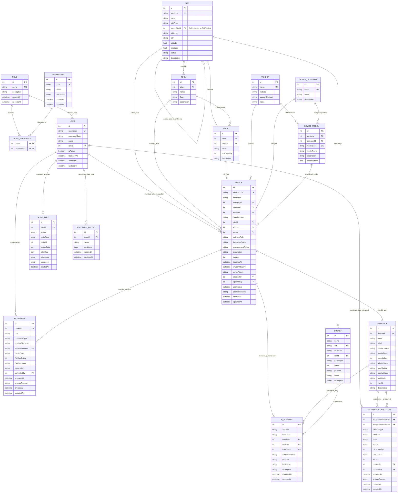

# Dokumen Desain Basis Data (ERD Final) & Matriks Hak Akses (RBAC)

Dokumen ini merupakan referensi teknis resmi struktur basis data relasional (**Entity Relationship Diagram / ERD**) dan spesifikasi **Role-Based Access Control (RBAC)** pada aplikasi **Network Inventory Management System (NIMS)** sesuai implementasi produksi.

---

## 1. Diagram Relasi Entitas (ERD Mermaid)

---

## 2. Kamus Data (Data Dictionary)

### 2.1 Tabel `devices`
Menyimpan data induk seluruh inventaris perangkat jaringan ISP.
- **`id`** (`INTEGER`, PK, Auto-increment): Identifier unik internal perangkat.
- **`deviceCode`** (`VARCHAR(50)`, UK, Not Null): Kode inventaris atau Asset Tag unik (contoh: `NOC-RTR-001`).
- **`hostname`** (`VARCHAR(100)`, Not Null): Nama host perangkat jaringan (contoh: `cr01.bdg.isp.net.id`).
- **`categoryId`** (`INTEGER`, FK ke `device_categories.id`, Not Null): Kategori perangkat (Router, Switch, OLT, dll).
- **`vendorId`** (`INTEGER`, FK ke `vendors.id`, Not Null): Pabrikan perangkat (Cisco, MikroTik, Huawei, Juniper).
- **`modelId`** (`INTEGER`, FK ke `device_models.id`, Nullable): Tipe/model spesifik perangkat.
- **`serialNumber`** (`VARCHAR(100)`, Nullable): Nomor seri pabrikan perangkat untuk klaim garansi.
- **`siteId`** (`INTEGER`, FK ke `sites.id`, Not Null): Lokasi POP/DC fisik perangkat terpasang.
- **`roomId`** / **`rackId`** (`INTEGER`, FK, Nullable): Penempatan spesifik di ruangan dan rak server.
- **`networkRole`** (`VARCHAR(50)`, Nullable): Peran arsitektural dalam topologi (`core`, `distribution`, `access`, `aggregation`, `cpe`, `server`, `other`).
- **`inventoryStatus`** (`VARCHAR(50)`, Default: `'PLANNED'`): Status siklus hidup perangkat (`PLANNED`, `ACTIVE`, `MAINTENANCE`, `RETIRED`, `LOST`).
- **`version`** (`INTEGER`, Default: `1`, Not Null): Nomor versi kontrol konkurensi (*Optimistic Locking* untuk mencegah *lost update*).
- **`archivedAt`** / **`archiveReason`** (`TIMESTAMP` / `TEXT`, Nullable): Penanda *soft delete* saat perangkat dinonaktifkan dari inventaris aktif.

### 2.2 Tabel `interfaces`
Menyimpan port antarmuka fisik dan logis perangkat.
- **`id`** (`INTEGER`, PK, Auto-increment).
- **`deviceId`** (`INTEGER`, FK ke `devices.id`, On Delete Cascade): Perangkat pemilik port.
- **`name`** (`VARCHAR(100)`, Not Null): Nama teknis port (contoh: `GigabitEthernet0/0/1`, `eth1`, `sfp-sfpplus1`).
- **`interfaceType`** (`VARCHAR(50)`, Default: `'ethernet'`): Tipe port (`ethernet`, `sfp`, `sfp_plus`, `qsfp`, `pon`, `wireless`, `loopback`, `vlan`, `lag`, `management`).
- **`mediaType`** (`VARCHAR(50)`, Nullable): Media transmisi (`copper`, `fiber_single_mode`, `fiber_multi_mode`, `wireless`).
- **`speedMbps`** (`INTEGER`, Nullable): Kapasitas bandwidth port (10, 100, 1000, 10000, 40000, 100000).
- **`adminStatus`** (`VARCHAR(20)`, Default: `'enabled'`): Status administratif (`enabled`, `disabled`).
- **Constraint Unik:** `UNIQUE (deviceId, name)`. Satu perangkat tidak boleh memiliki dua port dengan nama yang sama.

### 2.3 Tabel `network_connections`
Menyimpan relasi topologi antarmuka jaringan yang menghubungkan dua perangkat.
- **`id`** (`INTEGER`, PK, Auto-increment).
- **`endpointAInterfaceId`** (`INTEGER`, FK ke `interfaces.id`, On Delete Cascade): Port di sisi A.
- **`endpointBInterfaceId`** (`INTEGER`, FK ke `interfaces.id`, On Delete Cascade): Port di sisi B.
- **`relationType`** (`VARCHAR(50)`, Default: `'physical'`): Tipe relasi (`physical`, `logical`, `parent_child`, `service`).
- **`medium`** (`VARCHAR(50)`, Nullable): Media kabel fisik (`fiber`, `copper`, `wireless`).
- **`capacityMbps`** (`INTEGER`, Nullable): Kapasitas link koneksi.
- **`status`** (`VARCHAR(50)`, Default: `'documented'`): Status relasi (`documented`, `under_review`, `archived`).
- **`version`** (`INTEGER`, Default: `1`, Not Null): Optimistic locking version.
- **Aturan Integritas DB & Bisnis:**
  1. $A \neq B$: Port sumber tidak boleh sama dengan port tujuan.
  2. Anti-duplikasi: Pasangan $(A, B)$ atau $(B, A)$ tidak boleh terdaftar ganda.
  3. Relasi fisik aktif tunggal: Satu port fisik aktif hanya boleh terhubung ke satu kabel fisik aktif.

### 2.4 Tabel `subnets` & `ip_addresses` (IPAM Dasar)
- **`subnets`**:
  - `cidr` (`VARCHAR(50)`, UK): Alamat CIDR subnet (contoh: `10.10.0.0/24`).
  - `gatewayIp` (`VARCHAR(50)`, Nullable): Gateway router subnet.
  - `purpose` (`VARCHAR(50)`): Peruntukan (`management`, `loopback`, `point_to_point`, `access`, `server`).
- **`ip_addresses`**:
  - `address` (`VARCHAR(50)`, Not Null): Alamat host IPv4 (contoh: `10.10.0.15`).
  - `subnetId` (`INTEGER`, FK ke `subnets.id`): Subnet penampung.
  - `deviceId` (`INTEGER`, FK ke `devices.id`, Nullable): Perangkat yang mengklaim IP.
  - `purpose` (`VARCHAR(50)`, Default: `'management'`): Tujuan alokasi.
  - `allocationStatus` (`VARCHAR(20)`, Default: `'AVAILABLE'`): Status (`AVAILABLE`, `ALLOCATED`, `RESERVED`, `RELEASED`).
  - **Constraint Unik:** `UNIQUE (subnetId, address)`.

### 2.5 Tabel `documents`
Penyimpanan metadata berkas lampiran privat (diagram, konfigurasi, BAST).
- `originalFilename`: Nama asli saat diunggah oleh pengguna.
- `storedFilename`: Nama acak UUID di penyimpanan privat (contoh: `6ff4e050-6910-42ff-b7eb-867e7f6ed854.cfg`).
- `fileChecksum`: Hash SHA-256 untuk mendeteksi korupsi atau manipulasi data berkas.
- `mimeType` & `fileSizeBytes`: Whitelist tipe berkas dan batas ukuran aman.

### 2.6 Tabel `audit_logs`
Pencatatan riwayat audit keamanan dan jejak transaksi (*immutable audit trail*).
- `userId` (`INTEGER`, FK ke `users.id`): Pelaku aksi.
- `action` (`VARCHAR(50)`): Kode aksi (`CREATE`, `UPDATE`, `DELETE`, `ARCHIVE`, `RESTORE`, `LOGIN`, `LOGOUT`, `EXPORT`, `IMPORT`, `ACCESS_DENIED`, dll).
- `entityType` / `entityId`: Objek target.
- `beforeData` / `afterData`: Payload snapshot JSON (kredensial otomatis disanitasi `[REDACTED]`).
- `ipAddress` / `userAgent`: Jejak koneksi jaringan penyerang/pengguna.

### 2.7 Tabel `topology_layouts`
Menyimpan posisi koordinat node visual kanvas React Flow.
- `userId` (`INTEGER`, FK ke `users.id`): Pemilik tata letak (isolasi per pengguna).
- `scope` (`VARCHAR(50)`, Default: `'default'`): Scope layout (global atau per ID site).
- `positions` (`JSON`): Pasangan koordinat `{ [deviceId]: { x, y } }`.

---

## 3. Matriks Hak Akses (Role-Based Access Control / RBAC)

Sistem NIMS menerapkan pemisahan tugas (*separation of duties*) menggunakan 5 peran utama:

| Kode Permission | Deskripsi Hak Akses | Admin | Network Engineer | Operator NOC | Supervisor | Auditor |
|---|---|:---:|:---:|:---:|:---:|:---:|
| `device.view` | Melihat daftar perangkat, detail, port, dan relasi | ✅ | ✅ | ✅ | ✅ | ✅ |
| `device.create` | Mendaftarkan perangkat baru & mengeksekusi impor CSV | ✅ | ✅ | ❌ | ❌ | ❌ |
| `device.update` | Mengedit data perangkat, menambah port, & membuat relasi | ✅ | ✅ | ✅ | ❌ | ❌ |
| `device.archive` | Mengarsipkan atau memulihkan perangkat/relasi | ✅ | ✅ | ❌ | ❌ | ❌ |
| `ipam.view` | Melihat daftar subnet dan alokasi alamat IP | ✅ | ✅ | ✅ | ✅ | ✅ |
| `ipam.manage` | Membuat subnet, mengalokasikan IP, & melepas IP | ✅ | ✅ | ❌ | ❌ | ❌ |
| `document.view` | Mengunduh dan melihat lampiran dokumen privat | ✅ | ✅ | ✅ | ✅ | ✅ |
| `document.upload` | Mengunggah diagram/konfigurasi ke storage privat | ✅ | ✅ | ❌ | ❌ | ❌ |
| `document.delete` | Menghapus atau mengarsipkan dokumen lampiran | ✅ | ❌ | ❌ | ❌ | ❌ |
| `report.export` | Mengekspor data perangkat dan audit log ke berkas CSV | ✅ | ✅ | ❌ | ✅ | ✅ |
| `audit.view` | Mengakses halaman audit log dan peninjau diff data | ✅ | ❌ | ❌ | ✅ | ✅ |
| `user.manage` | Mengelola akun pengguna, peran, dan hak akses sistem | ✅ | ❌ | ❌ | ❌ | ❌ |

---

## 4. Penegakan Keamanan Hak Akses

1. **Lapisan Server Component (UI Protection):**
   Memanggil `requirePermission(code)` pada level halaman Next.js. Pengguna tanpa hak akses akan dialihkan secara aman atau disajikan halaman `403 Forbidden`.
2. **Lapisan Route Handler (API Boundary):**
   Setiap endpoint API memanggil `requireApiPermission(code, req)`. Jika token/session tidak memiliki hak yang cukup:
   - Request ditolak dengan kode respon `HTTP 403 Forbidden`.
   - Insiden penolakan otomatis dicatat ke tabel `audit_logs` dengan `action: 'ACCESS_DENIED'`, mencatat ID pengguna, alamat IP penyerang, dan URL endpoint yang dicoba ditembus.
